# Поознакові трасування рішень класифікатора

Приклади поознакового трасування помилок різних класів і правильних рішень системи NaturalAGI на тестовому розбитті MNIST. Методика та сама, що в статті для пари 2→7: кожне число отримано запуском production-коду класифікації (`src/classification`) на графах зображень, збережених у Neo4j під час експерименту.

## Умови експерименту

| Параметр | Значення |
|---|---|
| Експеримент | `experiments/run_20261023_155807` |
| Код | коміт `a25d24a` |
| Навчальний корпус | `datasets.zip`, `datasets/train`, 869 PNG |
| Концепти | 13, перенавчені 23.10.2026 |
| Параметри класифікації | ті самі, що в `experiments/run_20260630_235356/run_config.json` |
| D33 (пом'якшення меж) | вимкнено, `CLASSIFICATION_RANGE_GATE_REL_WIDTH = 0` (`../deployment.json`) |
| Тестова множина | 8 704 повні зображення `mnist_all` |
| Точність | 90,05 % (7 819 з 8 683 класифікованих) |

Координати точок нижче подано в пікселях зображення 100 × 100, вісь y спрямована вниз.

## Як рахується рішення

1. Бінаризація з порогом 110, скелетизація, обрізання гілок «перетин → кінець», коротших за max(8 % довжини скелета, 5 px). GNG (ε = 4,55) будує граф точок E (кінцева), C (кутова), I (перетину) і векторів V між ними. Складність графа = вузли + ребра.
2. Фільтр складності не порівнює концепт, складніший за зображення.
3. Передобробка під кожен концепт: `StartPointPreprocessor` ставить на зображенні початкову точку S, `CriticalPointPreprocessor` до 5 ітерацій зводить кінцеві, перетину й кутові точки. Невдача дає `is_minor = false`, подібність 0 і повідомлення `Preprocessing failed: …`. Повідомлення описує граф після цих кроків, а не вихідний граф зображення.
4. GED (`nx.optimize_edit_paths`): видалення вузла чи ребра зображення коштує 0,25, вставка вузла концепту — 6, вставка ребра — 0, заміна вузлів із різними мітками — 6. Заміна вузла = сума за 13 ознаками. Ознака поза діапазоном концепту коштує 1. Ознака в діапазоні коштує min(w·|v − центр| / півширини, w), де w нормовано на ознаки, наявні в обох вузлах. Кожен пошук закінчився за ≤ 0,016 с, тож GED — точний мінімум.
5. Подібність = round(1 − GED / (GED + max(n₁, n₂)), 4), де n — вузли + ребра після передобробки. Ранжування: спершу допущені концепти (`is_minor`), потім скоригована оцінка = подібність + 0,10·log₂(складність концепту).

## 820 помилок за механізмами

`../incorrect_results.csv` має 885 рядків: 21 зображення не пройшло конвеєр (DLQ), 44 не активували жодного концепту, 820 віднесено до хибного класу. Кожну з 820 помилок віднесено до одного механізму за полем `classification_results`.

| Механізм | Визначення | Помилок |
|---|---|---|
| Гейт | Жоден концепт істинного класу не допущений до порівняння: 277 відкинула передобробка, 31 фільтр складності, у 4 один концепт відсіяв фільтр, а другий передобробка | 312 (38,0 %) |
| Подібність | Концепт істинного класу допущений, але його сира подібність нижча, ніж у переможця | 383 (46,7 %) |
| Пріор | Концепт істинного класу має сиру подібність ≥ переможця і програє після доданку 0,10·log₂(складність); без пріору 113 відповідей стали б правильними, у 12 виграв би третій концепт | 125 (15,2 %) |

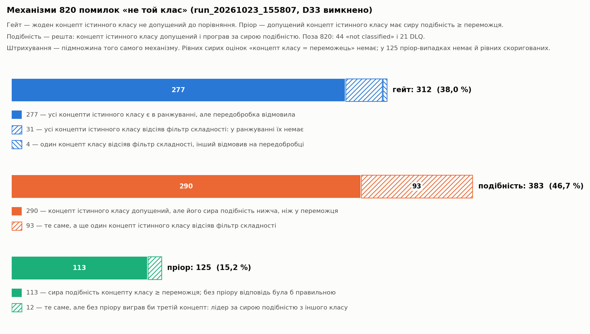

Десять найчастіших пар дають 542 з 820 помилок (66,1 %): 2 → 7 — 93 (подібність 90), 4 → 7 — 80 (гейт 36, подібність 44), 4 → 5 — 71 (гейт 26, подібність 45), 2 → 6 — 65 (гейт 56), 5 → 3 — 56 (пріор 55), 0 → 6 — 52 (подібність 46), 4 → 1 — 41 (гейт 40), 2 → 3 — 31 (подібність 21, пріор 10), 9 → 4 — 27 (усі подібність), 7 → 2 — 26 (пріор 21).

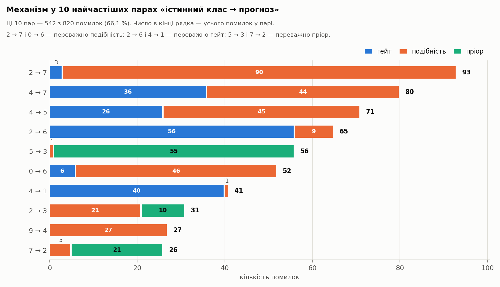

Причини гейта, 484 відмови концептам істинного класу: «нема кінцевих» 141, «нема кутових» 115, «нема точок перетину» 111, «5 ітерацій без ізоморфізму» 39, «замало кутових» 37, фільтр складності 35, «замало кінцевих» 5, «нема шляху від кінцевої» 1. За зображеннями найчастіше трапляється «нема кутових + нема точок перетину» — 100 помилок, усі класу 4.

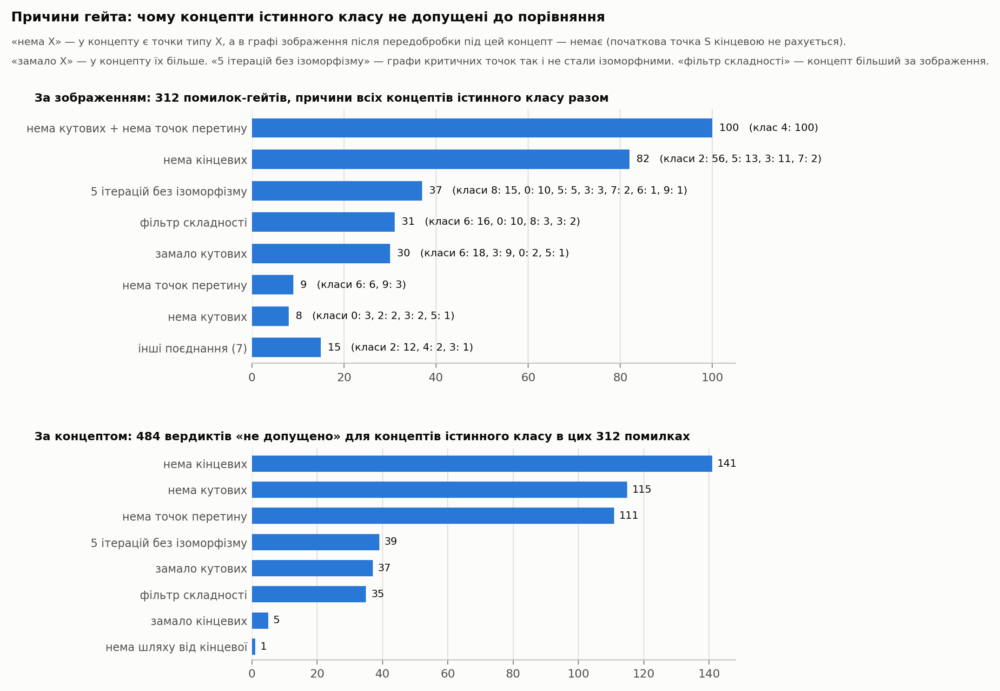

## Випадок 1 · mnist_test_5_00606 · 5 → 3_1 · пріор

| Концепт | GED | Ознак поза діапазоном | Подібність | Складність | Скоригована |
|---|---|---|---|---|---|
| 5_1, істинний клас | 6,7259 | 1 | 0,7880 | 13 | 1,1580 |
| 3_1, прогноз | 7,8362 | 2 | 0,7614 | 17 | 1,1701 |

1. Скелет має 122 пікселі. Обрізання прибрало відросток 6,8 px (поріг 11,0 px). Граф — один відкритий штрих: 7 точок (E1, E2, C1–C5), 6 векторів, складність 25.
2. Фільтр складності нікого не відсіяв. Передобробка відмовила 8 концептам: 0_1 і 8_1 («нема кутових»), 1_1 і 4_2 («у концепту більше кінцевих»), 2_2, 4_1, 6_1, 9_2 («нема точок перетину»).
3. 5_1: E2 стає початковою точкою S, C1, C2, C4 знижено до простих точок P. GED 6,7259 = заміни 7 вузлів 2,9759 + видалення 6 вузлів 1,5 + видалення 9 ребер 2,25. Одна ознака поза діапазоном: C3 → C1, `normalized_x` 0,5 ∉ [−0,8; −0,1].
4. 3_1: E2 → S, C2 і C5 → P. GED 7,8362 = заміни 9 вузлів 4,8362 + видалення 4 вузлів 1,0 + видалення 8 ребер 2,0. Поза діапазоном: E1 → E, `normalized_x` 0,8 ∉ [−0,7; 0,3]; V3 → V1, `normalized_y` −0,1 ∉ [−0,9; −0,5].
5. 5_1 веде за сирою оцінкою на 0,0266, пріор дає 3_1 на 0,0387 більше, і 3_1 виграє на 0,0121. Без пріору переміг би 5_1.

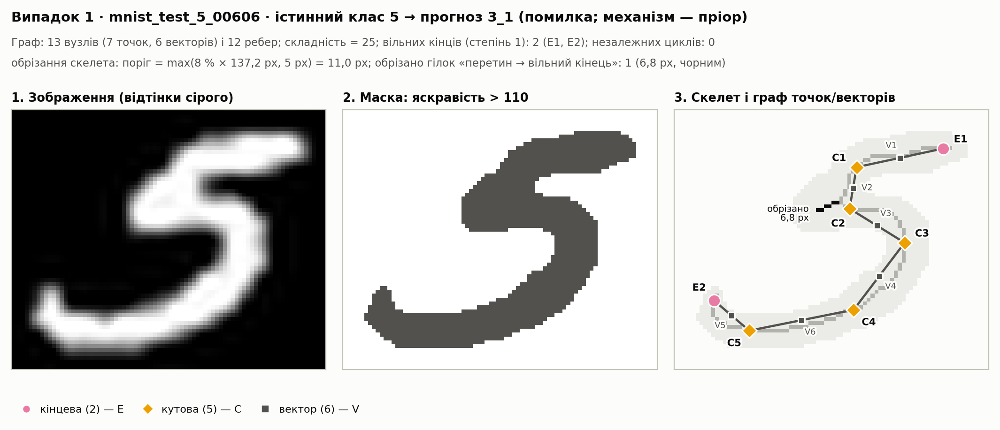
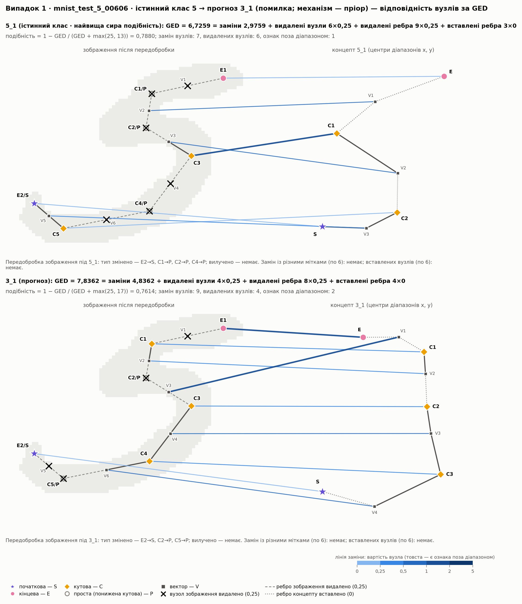
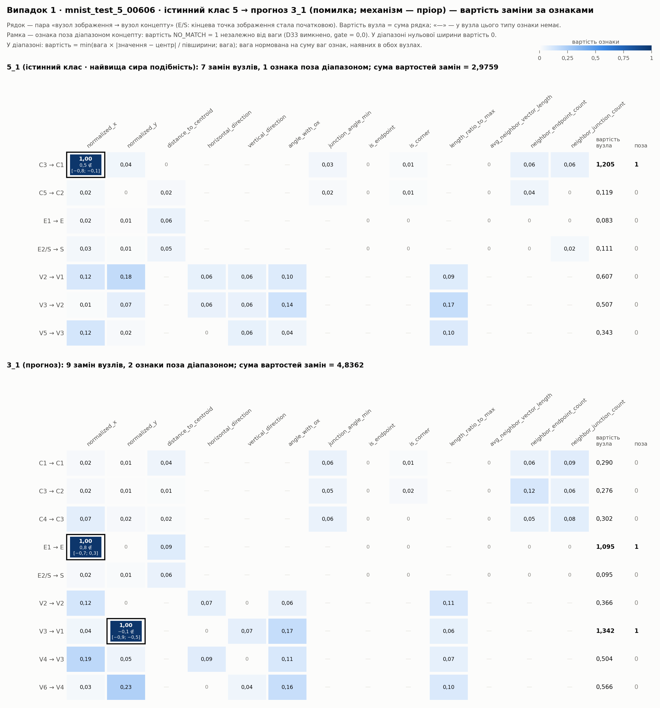
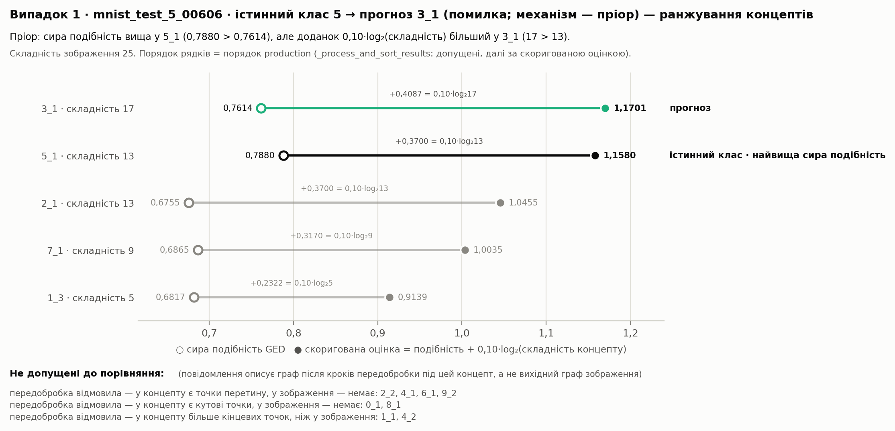

## Випадок 2 · mnist_test_2_00144 · 2 → 6_1 · гейт

| Концепт | GED | Ознак поза діапазоном | Подібність | Складність | Скоригована |
|---|---|---|---|---|---|
| 2_1, 2_2, істинний клас | — | — | 0, відмова передобробки | — | — |
| 6_1, прогноз | 14,4297 | 7 | 0,6892 | 20 | 1,1214 |

1. Скелет має 168 пікселів. Обрізання прибрало хвіст нижнього штриха 12,5 px від перетину (57, 69) до кінця (67, 75) при порозі 15,7 px. Низ «2» став замкненою петлею.
2. Граф: E (32,1; 24,9) — вільний кінець верхнього штриха; I (56,5; 66,1) степеня 3; C1–C6; 8 векторів; 1 цикл; складність 32.
3. 2_1 і 2_2 очікують S степеня 1. `StartPointPreprocessor` робить S з єдиного вузла степеня 1, тобто з вільного кінця E. `EndpointReductionStrategy.reduce` рахує кінцевими вузли E або степеня 1 без мітки S: у зображенні їх 0, у 2_1 і 2_2 — по одній. Звідси `ValueError("Concept has endpoints but image does not.")`.
4. Отже, «2» має вільний кінець штриха, але лише один, і його забирає S. Другий кінець, хвіст основи, зник під час обрізання скелета.
5. Допущено 6_1, 9_2 і 4_1: у кожного петля, точка перетину і жодної кінцевої, окрім S. 6_1: GED 14,4297 = заміни 10 вузлів 9,6797 + видалення 6 вузлів 1,5 + видалення 13 ребер 3,25. Сім ознак поза діапазоном, зокрема C6 → C2 і C4 → C1 за `normalized_x`, I → I за `normalized_x`, V5 → V2 за `length_ratio_to_max` 0,9293 ∉ [0,2716; 0,8255].
6. Пріор порядку не змінює: 6_1 > 9_2 > 4_1 і за сирою оцінкою (0,6892; 0,6742; 0,6441), і за скоригованою.

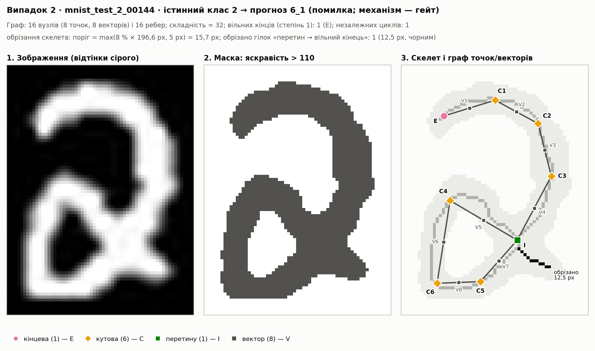
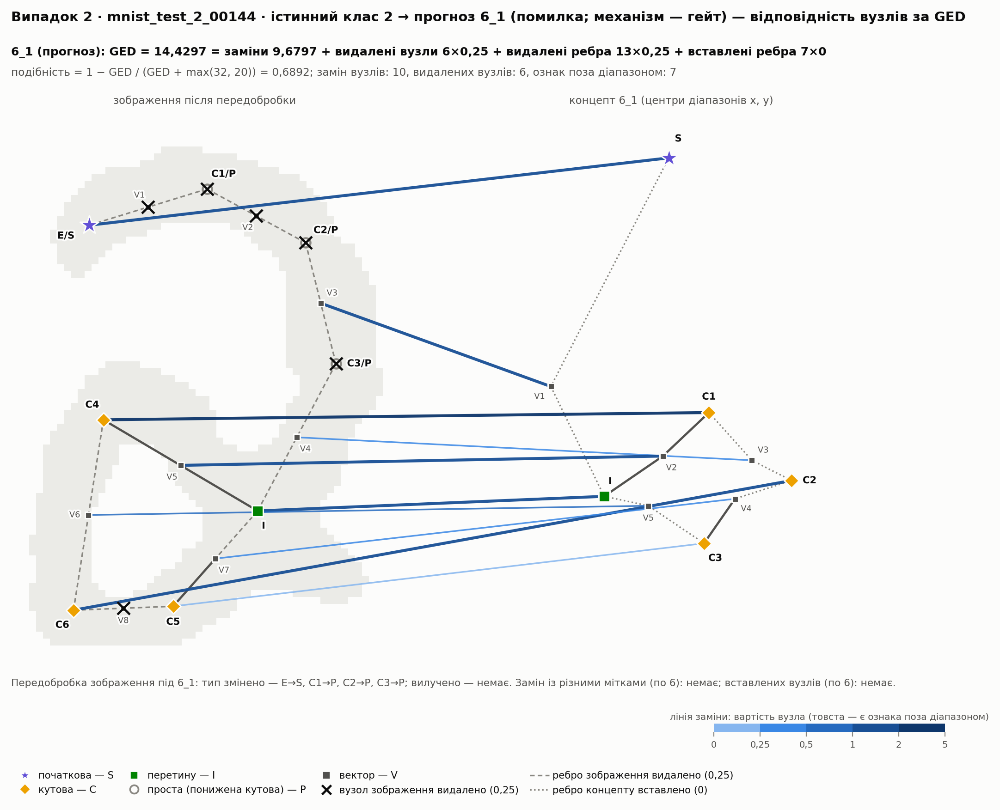
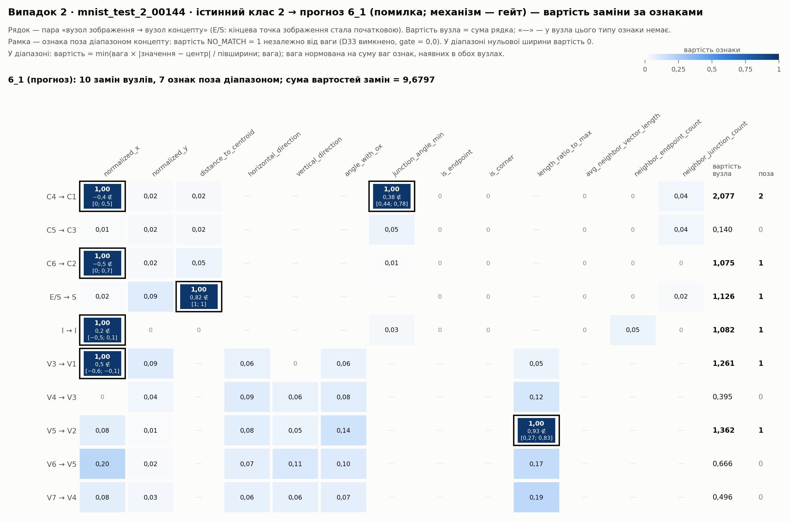
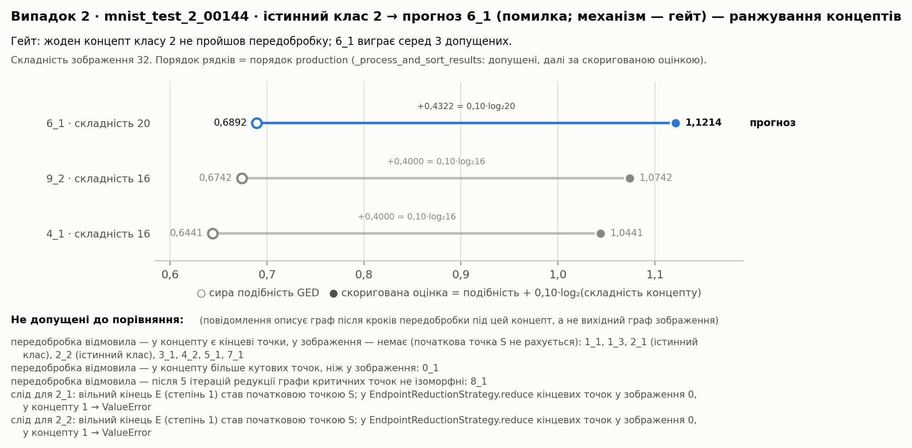

## Випадок 3 · mnist_test_0_00701 · 0 → 6_1 · подібність

| Концепт | GED | Ознак поза діапазоном | Подібність | Складність | Скоригована |
|---|---|---|---|---|---|
| 0_1, істинний клас | 16,9016 | 12 | 0,5868 | 20 | 1,0190 |
| 6_1, прогноз | 11,3243 | 5 | 0,7120 | 20 | 1,1442 |

1. Скелет має 142 пікселі, обрізання нічого не прибрало: верхній відросток 15,4 px довший за поріг 13,1 px. Решта скелета — петля 149 px.
2. Граф: E (50,3; 19,8), I (50,1; 33,4) степеня 3, C1–C5, 7 векторів, 1 цикл, складність 28. Топологія та сама, що в «6»: петля і один вільний кінець.
3. 0_1 — петля без кінцевих: S, 4 C, 5 V, і S у нього кутова. Передобробка прибирає з зображення відросток E–V1 і ставить S на I. GED 16,9016 = заміни 10 вузлів 14,6516 + видалення 2 вузлів 0,5 + видалення 7 ребер 1,75.
4. Чотири з 12 ознак поза діапазоном припадають на S (колишню I), вартість цього вузла 4,1419: `normalized_y` −0,4 ∉ [−0,8; −0,5]; `distance_to_centroid` 0,575 ∉ [0,6022; 0,8008]; `junction_angle_min` 0,5733 ∉ [0,6078; 0,7922]; `is_corner` 0 ∉ [1; 1].
5. 6_1: E → S, C1 і C5 → P. GED 11,3243 = заміни 10 вузлів 7,8243 + видалення 4 вузлів 1,0 + видалення 10 ребер 2,5. П'ять ознак поза діапазоном.
6. Пріор не впливає: обидва концепти мають складність 20. За сирою оцінкою 0_1 лише четвертий: 6_1 0,7120, 9_2 0,6489, 4_1 0,6392, 0_1 0,5868.
7. Один вектор концепту 0_1 не має ознак `normalized_x`, `normalized_y`, напрямків і `angle_with_ox`, тому заміну V2 → V1 оцінено лише за `length_ratio_to_max`.

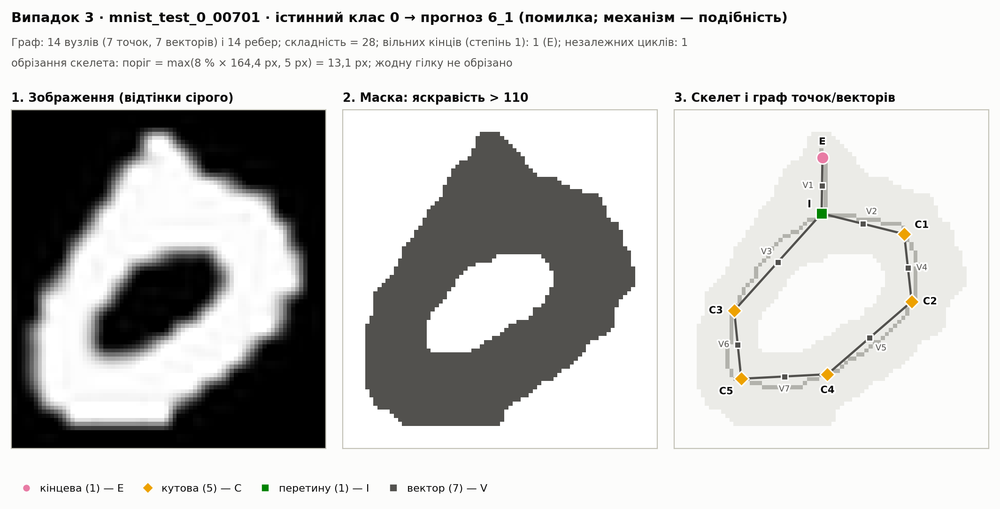
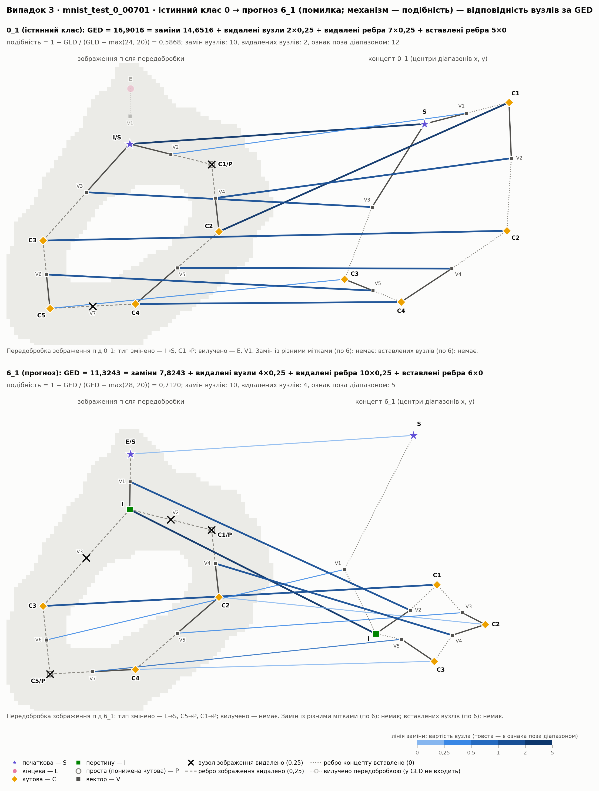
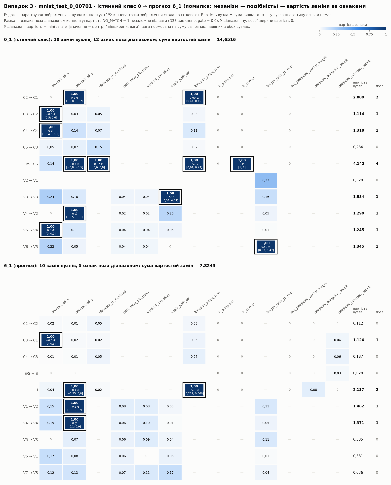
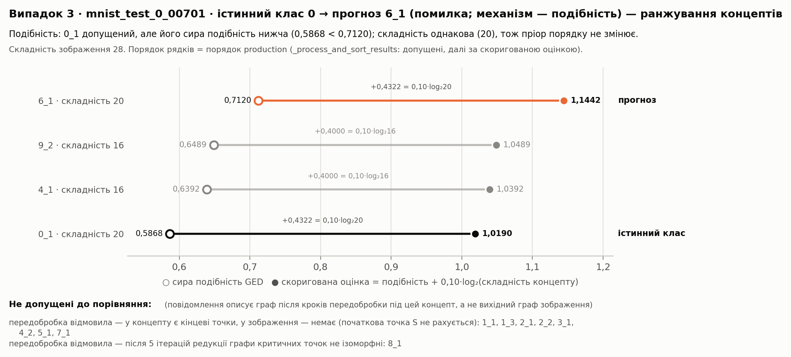

## Випадок 4 · mnist_test_7_00614 · 7 → 7_1 · правильно

| Концепт | GED | Ознак поза діапазоном | Подібність | Складність | Скоригована |
|---|---|---|---|---|---|
| 7_1, істинний клас і прогноз | 1,2154 | 0 | 0,8810 | 9 | 1,1980 |
| 1_3 | | | 0,7817 | 5 | 1,0139 |

1. Скелет має 84 пікселі й одну гілку «кінець → кінець». Граф: E1 (31,6; 29,6), C1 (59,0; 38,5), E2 (60,4; 91,4), 2 вектори, складність 9.
2. Фільтр складності відсіяв 11 з 13 концептів. Порівнювалися лише 7_1 і 1_3.
3. 7_1: E1 → S, нічого не вилучено. GED складається лише з 5 замін: S 0,0481, E 0,0505, C1 0,1902, V1 0,2972, V2 0,6295. Усі 4 ребра збігаються.

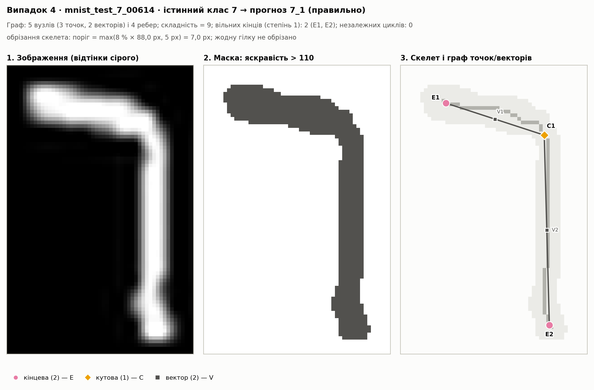
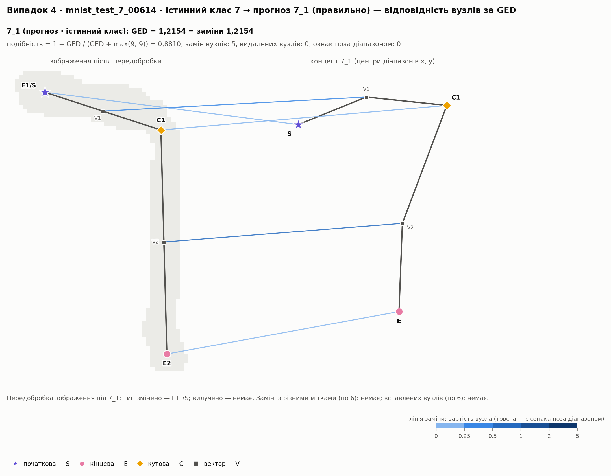
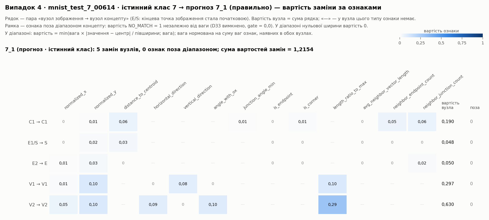
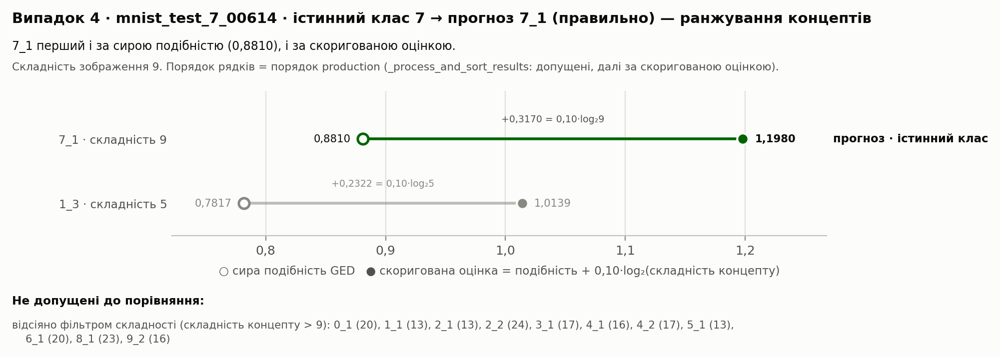

## Випадок 5 · mnist_test_2_00030 · 2 → 2_1 · правильно завдяки пріору

| Концепт | GED | Ознак поза діапазоном | Подібність | Складність | Скоригована |
|---|---|---|---|---|---|
| 2_1, істинний клас і прогноз | 6,6646 | 2 | 0,7591 | 13 | 1,1291 |
| 7_1 | 6,3487 | 2 | 0,7679 | 9 | 1,0849 |

1. Скелет має 100 пікселів, обрізання нічого не прибрало. У перетині (50, 64) сходяться три гілки: верхня 65,5 px, відросток 15,7 px, основа 35,6 px.
2. Граф: E1, E2, E3, I, C1–C3, 6 векторів, складність 25. Під 2_1 і 7_1 передобробка ставить S на E1 і прибирає відросток E2–V4.
3. 2_1: GED 6,6646 = заміни 7 вузлів 4,1646 + видалення 4 вузлів 1,0 + видалення 6 ребер 1,5. Поза діапазоном дві ознаки `distance_to_centroid`.
4. 7_1: GED 6,3487 = заміни 5 вузлів 3,0987 + видалення 6 вузлів 1,5 + видалення 7 ребер 1,75. Поза діапазоном `distance_to_centroid` у C1 і `normalized_y` у V2.
5. 7_1 веде за сирою оцінкою на 0,0088, пріор дає 2_1 на 0,0531 більше, і 2_1 виграє на 0,0442. Це дзеркало випадку 1: той самий доданок тут виправляє відповідь.

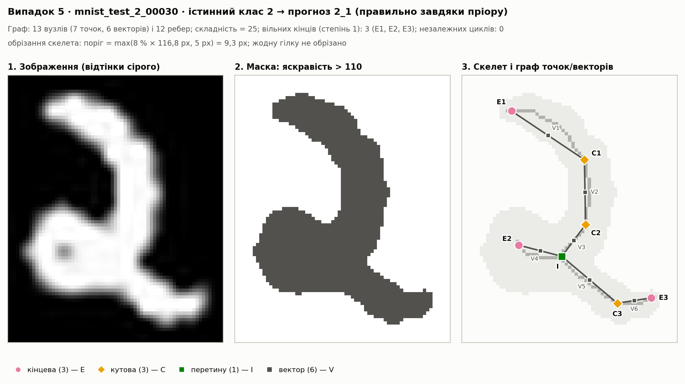
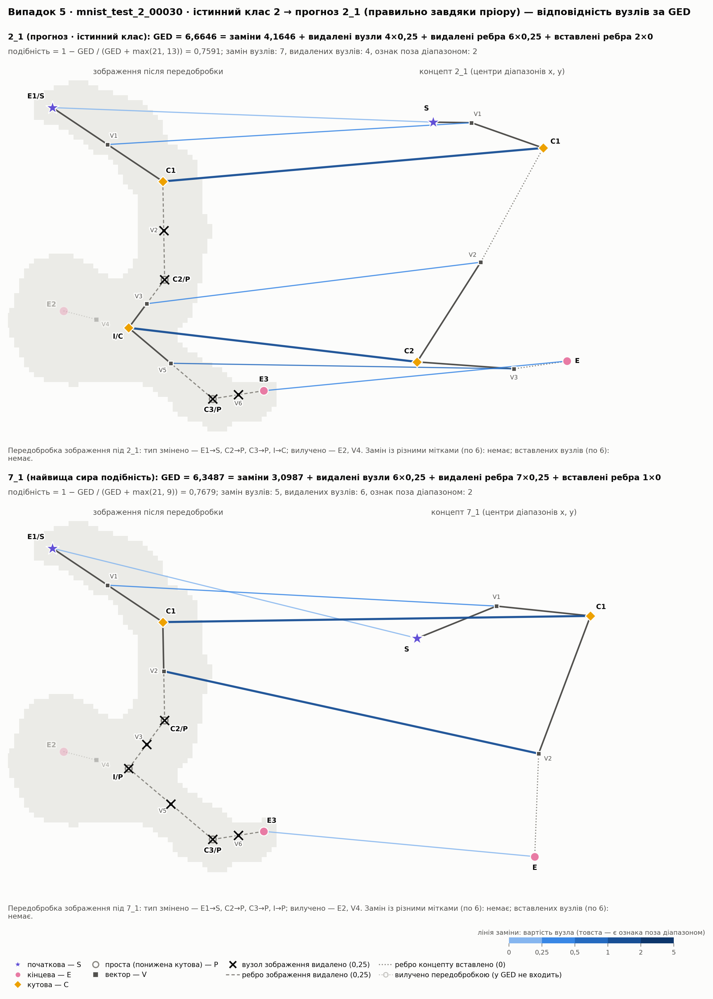
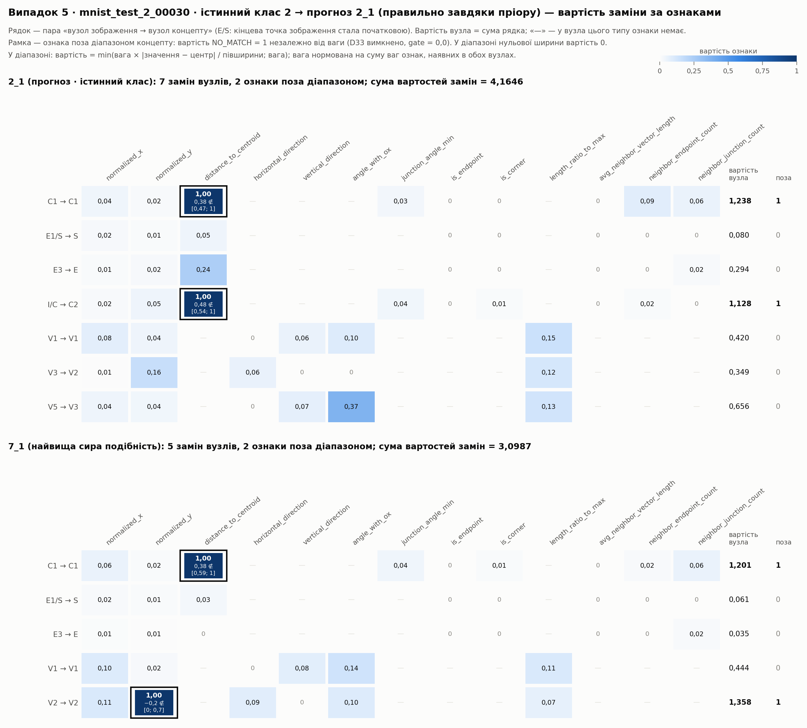
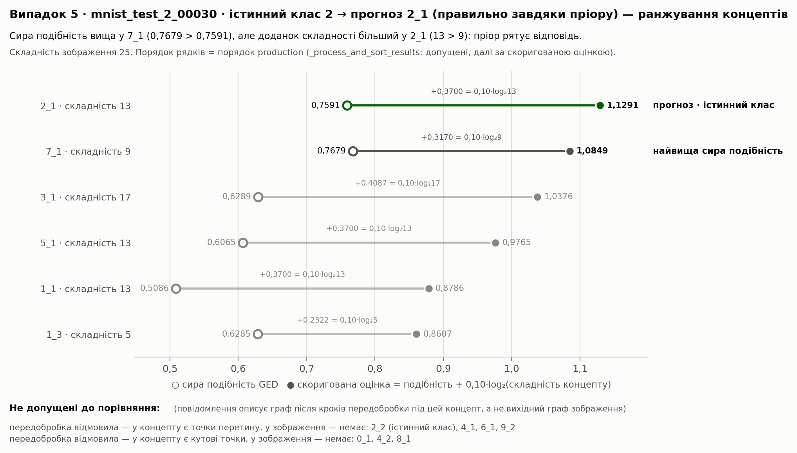

## Сирі трасування

Каталог `tool/` містить вивід інструмента трасування для 11 зображень. Блок `Ranking` дає сиру й скориговану оцінку кожного концепту, складність і допуск до порівняння. Далі для кожного вузла оптимального шляху GED наведено операцію (`SUBSTITUTE`, `DELETE`, `INSERT`), кожну спільну ознаку з діапазоном концепту, вагою й вартістю. `residual` — різниця між вартістю заміни вузла з production-коду і сумою вартостей ознак; нуль підтверджує, що розклад відтворює production.

| Файл | Зображення | Рішення | Механізм |
|---|---|---|---|
| `tool/5to3_5_00606.txt` | mnist_test_5_00606 | 5 → 3_1 | пріор |
| `tool/gate_2to6_2_00144.txt` | mnist_test_2_00144 | 2 → 6_1 | гейт |
| `tool/gate_4to1_4_00755.txt` | mnist_test_4_00755 | 4 → 1_1 | гейт |
| `tool/sim_0to6_0_00701.txt` | mnist_test_0_00701 | 0 → 6_1 | подібність |
| `tool/sim_2to7_2_00697.txt` | mnist_test_2_00697 | 2 → 7_1 | подібність |
| `tool/sim_4to5_4_00047.txt` | mnist_test_4_00047 | 4 → 5_1 | подібність |
| `tool/ok_7_00614.txt` | mnist_test_7_00614 | 7 → 7_1 | правильно |
| `tool/ok_2_00030.txt` | mnist_test_2_00030 | 2 → 2_1 | правильно завдяки пріору |
| `tool/ok_3_00997.txt` | mnist_test_3_00997 | 3 → 3_1 | правильно |
| `tool/ok_4_00278.txt` | mnist_test_4_00278 | 4 → 4_2 | правильно |
| `tool/ok_8_00263.txt` | mnist_test_8_00263 | 8 → 8_1 | правильно, допущено лише 8_1 |

`tool/mechanisms.txt` — розклад 820 помилок за механізмами і парами.
